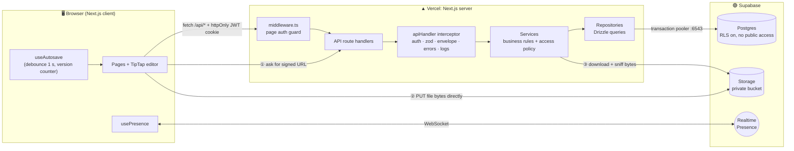
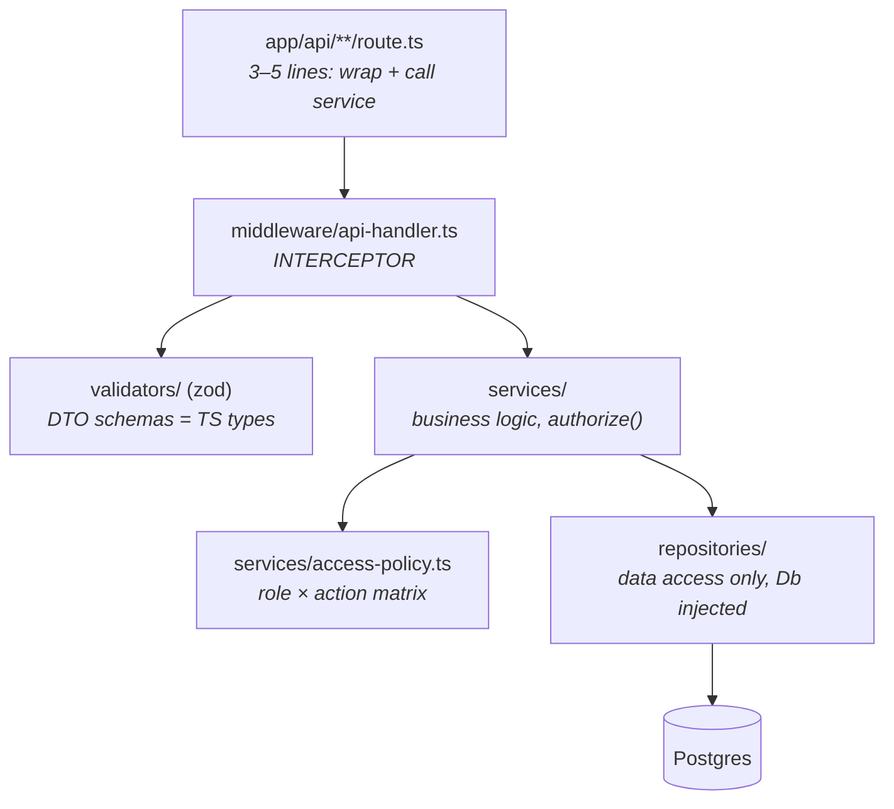
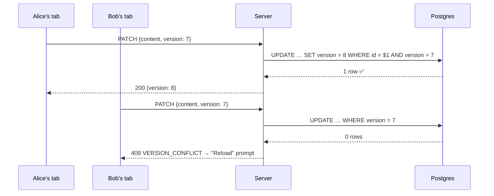
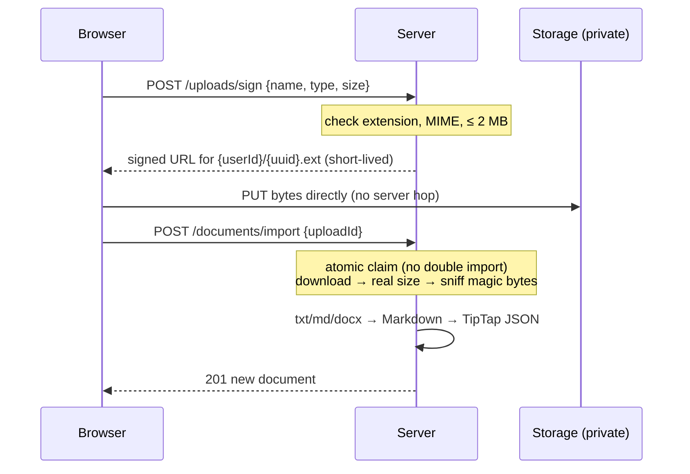

# Architecture Note

> **Ajaia Docs** is a Google-Docs-style editor: create, format, import, share, comment, version and export documents.
> **Next.js 15 (TypeScript) · Drizzle ORM · Supabase (Postgres, Storage, Realtime) · Vercel**

---

## 1. What I prioritized

The brief rewards **depth over shallow coverage**, so the core loop comes first and every extra is an independent, cuttable slice.

| Priority | What | Why |
|:-:|---|---|
| **1** | **A trustworthy document loop.** Create → edit → autosave → reopen, stored as structured TipTap JSON, with **optimistic locking** | Losing or silently overwriting someone's text is the worst failure a docs app can have |
| **2** | **Production-grade upload and sharing.** Signed-URL uploads, byte-level type sniffing, one server-side access policy | These are where security mistakes usually happen |
| **3** | **Collaboration extras.** Presence, comments, version history, export | Visible value, each shippable on its own |

---

## 2. Why a modular monolith in one Next.js app

| Option | Verdict |
|---|---|
| Next.js frontend + Python (FastAPI) backend | ❌ No AI workload to justify it. Two deploys, CORS, duplicated types, and a ~50 s free-tier cold start in front of the reviewer |
| Microservices | ❌ A small app and one developer: network hops and distributed failure modes with no benefit |
| ✅ **One Next.js app, modular monolith inside** | One deploy, **types shared end to end**, no CORS. The backend is still strictly layered, so a module could later be extracted as a service |

---

## 3. System diagram



---

## 4. Backend layers



| Folder | Job |
|---|---|
| `config/` | Env vars validated with zod at startup; the app fails fast if one is missing |
| `constants/` | Limits, error codes, cookie name: no magic numbers |
| `exceptions/` | `AppError` → `ValidationError`, `NotFound`, `Forbidden`, `Conflict`… + a mapper to HTTP |
| `types/` | Domain + API types shared by client and server |
| `validators/` | zod schemas for every request (params, query, body) |
| `services/` | Business rules; know nothing about HTTP |
| `repositories/` | SQL via Drizzle; get `Db` by constructor injection, so tests pass in PGlite |
| `container.ts` | Composition root: the only place classes are wired to the real DB and storage |

**Rule:** dependencies only point down. Route → service → repository → DB.

---

## 5. Request / response contract (DTOs)

Every endpoint returns the same shape, so the client handles them all with one code path.

```jsonc
// ✅ success
{ "data": { "id": "…", "title": "Q3 plan", "version": 7 } }

// ❌ failure
{ "error": { "code": "VERSION_CONFLICT", "message": "Document was changed by someone else", "details": null } }
```

| Status | `code` | When |
|:-:|---|---|
| 400 | `VALIDATION_ERROR` | zod rejected params, query or body (`details` lists the fields) |
| 401 | `UNAUTHENTICATED` | No or invalid session |
| 403 | `FORBIDDEN` | You can see the document but lack the permission |
| 404 | `NOT_FOUND` | Doesn't exist **or you have no access** (existence is never leaked) |
| 409 | `VERSION_CONFLICT` | Stale save |
| 413 / 415 / 422 | `PAYLOAD_TOO_LARGE` / `UNSUPPORTED_FILE_TYPE` / `INVALID_FILE_CONTENT` | Too large / wrong type / bytes don't match the type |

**What the interceptor does on every request:** request id → session check → zod validation → handler → `{ data }` envelope → any thrown error mapped to `{ error }` → access log line.

---

## 6. Data model

```mermaid
erDiagram
    users ||--o{ documents : owns
    users ||--o{ document_shares : "is granted"
    documents ||--o{ document_shares : "shared via"
    documents ||--o{ document_versions : snapshots
    documents ||--o{ comments : has
    comments ||--o{ comments : "replies (1 level)"
    users ||--o{ uploads : uploads

    documents { uuid id PK; uuid owner_id FK; text title; jsonb content; int version; timestamptz last_snapshot_at }
    document_shares { uuid document_id FK; uuid user_id FK; enum role "viewer|editor" }
    document_versions { uuid document_id FK; int version; jsonb content }
    comments { uuid document_id FK; text anchor_id; text quote; uuid parent_id; bool resolved }
    uploads { uuid user_id FK; text path; enum status "pending|imported|rejected" }
```

- Schema changes go **only through versioned Drizzle migrations**.
- Migration `0001` turns on **RLS on every table with no policies**. Supabase's auto-generated REST API is otherwise readable with the *public* anon key.

---

## 7. Key flows

### 🔒 Save with optimistic locking



**One atomic statement:** no Redis, no lock server, no read-modify-write race. The same version counter feeds **version history**: an automatic snapshot at most every 5 min, manual snapshots, the newest 50 kept, and restore is non-destructive.

### 📤 File import with a signed URL



| Sniffing rule | Catches |
|---|---|
| `.docx` = ZIP magic `PK\x03\x04` **+** `word/document.xml` inside | Renamed `.txt`/`.exe`/random ZIP |
| `.txt/.md` = valid UTF-8, no NUL bytes, not ZIP/PDF/PNG magic | Binaries posing as text |

### 🟢 Real-time presence (WebSocket)

- Each open document joins the Supabase Realtime channel **`doc:<id>`** over a **WebSocket**.
- A client tracks `{name, isEditing}`. `isEditing` flips after a keystroke and clears after 2.5 s idle (debounced).
- Avatars show who is **viewing** and who is **editing**; multiple tabs of one user are de-duplicated.
- The effect cleanup untracks and removes the channel, so React Strict Mode's double mount never leaves a duplicate subscription.

### 🔑 Authentication

| Piece | Choice |
|---|---|
| Token | **JWT signed with HS256** (`jose`), secret from `SESSION_SECRET`, 7-day expiry |
| Storage | Cookie `ajaia_session`: **httpOnly** (no JS access → XSS can't steal it), **SameSite=Lax** (CSRF), **Secure** in production |
| Passwords | **bcrypt** hashes |
| Login | Unknown email and wrong password give the same error **and** take the same time (a dummy hash is checked), so accounts can't be enumerated |
| Redirects | `/login?next=` only accepts same-site paths (no open redirect) |

### 🛡️ Authorization

`resolveRole(user, doc)` → `owner | editor | viewer | null` → `assertCan(role, action)`

| Action | Owner | Editor | Viewer |
|---|:-:|:-:|:-:|
| View, export | ✅ | ✅ | ✅ |
| Comment | ✅ | ✅ | ✅ |
| Edit, restore version | ✅ | ✅ | ❌ 403 |
| Share, delete | ✅ | ❌ 403 | ❌ 403 |
| *No access* | 404 | | |

---

## 8. Trade-offs I made deliberately

| Decision | Trade-off |
|---|---|
| **Presence + optimistic locking instead of real-time co-editing (CRDT/Yjs)** | Real co-editing needs a sync server and CRDT state, which wasn't achievable well in the timebox. This choice is honest about collaboration and never loses data. |
| **Seeded users instead of Supabase Auth / signup** | The brief allows it; auth isn't what's being evaluated. I built my own session handling (cookie flags, timing-safe login) instead of wiring in a product. |
| **Suggestion mode dropped** | TipTap's track-changes is a paid Pro extension (the brief forbids paid dependencies); a custom build is 2+ h across every edit path. Comments cover the "feedback without editing" need. |
| **PDF via print stylesheet** | Zero dependencies, real selectable text. Downside: it uses the browser print dialog instead of a direct download. |
| **Markdown export is lossy for colors/underline** | Markdown has no syntax for them; this is documented. |
| **Viewer comments have no inline highlight** | The anchor lives in the document JSON, and viewers can't modify the document. Their comments store the quoted text instead. |
| **Presence channel uses the public anon key** | It only reveals who is looking at a document id you already know. Tables are protected by RLS. |

---

## 9. Next 2–4 hours

1. **Real-time co-editing** with Yjs + a TipTap collaboration provider.
2. **Playwright E2E** for login → create → share → viewer sees it.
3. Persist viewer comment anchors with relative positions stored server-side.
4. **Rate limiting** on login and upload signing; audit log of share changes.
5. Direct PDF download and `.docx` export.
