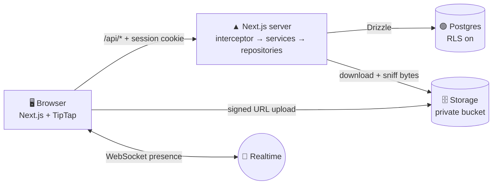

<div align="center">

# 📝 Ajaia Docs

*A lightweight, Google-Docs-style collaborative editor.*

**Write, format, import, share, comment, version and export documents, with live presence of who else is in the doc.**


[**▶ Try it live**](https://ajaia-collab-docs-eight.vercel.app) · [How it works](#-how-it-works) · [Run locally](#-run-locally) · [Architecture](ARCHITECTURE.md) · [AI workflow](AI_WORKFLOW.md)

</div>

## 🔑 Demo accounts

Password for all: **`password123`**. The login page also has one-click buttons.

| Account | What to try |
|---|---|
| `alice@ajaia.test` | Owns *Welcome to Ajaia Docs*. Create, share, import |
| `bob@ajaia.test` | Has the welcome doc as **Editor**. Edit it alongside Alice |
| `carol@ajaia.test` | Share something with her as **Viewer**. Read-only, can comment |

> 💡 Open a second browser (or a private window) as another user to see **live presence avatars**.

## ✨ What you get

| | |
|---|---|
| ✍️ **Rich text editor** | Bold, italic, underline, H1–H3, bullet and numbered lists, **tables**, **text and highlight colour**, undo/redo |
| 💾 **Autosave you can trust** | Debounced autosave with a *Saving… / Saved* indicator. A stale save gets **409 Conflict** instead of overwriting someone's work |
| 📤 **File import** | `.txt`, `.md`, `.docx` (≤ 2 MB) become editable documents. Uploads go **straight to storage via a signed URL**; the server checks the **real file type from its bytes** |
| 👥 **Sharing with roles** | Share by email as **Viewer** or **Editor**; change or revoke. Separate *My documents* and *Shared with me* lists |
| 🟢 **Live presence** | See who is **viewing** or **editing** the document right now (WebSocket, Supabase Realtime) |
| 💬 **Comments** | Comment on selected text, reply, resolve. Viewers can comment too |
| 🕓 **Version history** | Automatic + manual snapshots, preview, **non-destructive restore** |
| 📄 **Export** | Markdown download and PDF (print-to-PDF) |
| 🔐 **Secure by default** | httpOnly JWT cookie, bcrypt, timing-safe login, RLS on every table, one server-side permission policy |

## 🧠 How it works



| Piece | In one line |
|---|---|
| **Saving** | `UPDATE … WHERE version = expected`: one atomic statement. 0 rows changed → `409`, the user is asked to reload |
| **Uploading** | Server signs a short-lived URL → browser uploads directly → server downloads, sniffs magic bytes, converts to the editor format |
| **Permissions** | `owner / editor / viewer` × actions in one policy module. No access → `404`, not allowed → `403` |
| **Presence** | Each open doc joins channel `doc:<id>` and broadcasts *viewing* / *editing* |

Full design, diagrams and trade-offs: **[ARCHITECTURE.md](ARCHITECTURE.md)**.

## 🧰 Tech stack

| Layer | Choice |
|---|---|
| App | Next.js 15 (App Router), React 19, TypeScript strict, Tailwind CSS v4 |
| Editor | TipTap v3 (ProseMirror), content stored as JSON |
| Data | Supabase Postgres via Drizzle ORM, versioned migrations |
| Files | Supabase Storage (private bucket, signed URLs) |
| Realtime | Supabase Realtime Presence |
| Validation | zod v4 |
| Tests | Vitest + PGlite (real Postgres in-process) |

## 📚 Documentation

| Doc | What's inside |
|---|---|
| [ARCHITECTURE.md](ARCHITECTURE.md) | Diagrams, layers, API contract, data model, key flows, trade-offs |
| [AI_WORKFLOW.md](AI_WORKFLOW.md) | What I decided vs. what AI proposed, what I rejected, how I verified |
| [SUBMISSION.md](SUBMISSION.md) | Submission checklist and status |
| [docs/REQUIREMENTS.md](docs/REQUIREMENTS.md) | Functional and non-functional requirements |
| [docs/DECISIONS.md](docs/DECISIONS.md) | Decision log (D1–D21) |
| [docs/BUILD_PLAN.md](docs/BUILD_PLAN.md) | Phases and build plan |

## 🚀 Run locally

**Prerequisites:** Node.js 20+ and a free Supabase project.

```bash
git clone https://github.com/sagarrajak245/ajaia-collab-docs.git
cd ajaia-collab-docs
npm install
cp .env.example .env.local      # then fill in the values (see below)
npm run db:migrate              # creates tables + enables RLS
npm run db:seed                 # demo users + welcome document
npm run dev                     # http://localhost:3000
```

### Environment variables (`.env.local`)

| Variable | Where to find it |
|---|---|
| `DATABASE_URL` | Supabase → Connect → **Transaction pooler** (port 6543), `postgresql://…` |
| `SESSION_SECRET` | Any random string of 32+ characters (`openssl rand -base64 32`) |
| `NEXT_PUBLIC_SUPABASE_URL` | Supabase → Settings → API → Project URL |
| `NEXT_PUBLIC_SUPABASE_ANON_KEY` | Supabase → Settings → API → `anon` key (public; only used for Realtime) |
| `SUPABASE_SERVICE_ROLE_KEY` | Supabase → Settings → API → `service_role` key (**server only**) |
| `SUPABASE_STORAGE_BUCKET` | Name of a **private** Storage bucket (default `document-uploads`) |

### Storage bucket setup

Create a private bucket named `document-uploads`, then run this in the Supabase SQL editor:

```sql
update storage.buckets
set public = false,
    file_size_limit = 2097152,
    allowed_mime_types = array['text/plain','text/markdown','text/x-markdown',
      'application/vnd.openxmlformats-officedocument.wordprocessingml.document','application/octet-stream']
where id = 'document-uploads';
```

No storage policies are needed. Uploads are authorized by short-lived signed tokens issued by the server.

## 📜 Scripts

| Command | Purpose |
|---|---|
| `npm run dev` / `build` / `start` | Develop / build / serve |
| `npm test` | All tests (unit + integration) |
| `npm run test:unit` / `test:integration` | One layer only |
| `npm run typecheck` / `lint` | `tsc --noEmit` / ESLint |
| `npm run db:generate` / `db:migrate` / `db:seed` | Versioned migrations / apply / seed |

## 🧪 Tests

```bash
npm test     # 80 tests in 14 files, ~10 s, no external services needed
```

- **Unit tests:** access-policy permission matrix, request validators, upload content sniffing (magic bytes, UTF-8, NUL, size), Markdown/TipTap converters, session tokens.
- **Integration tests:** each service runs against **PGlite** (in-memory Postgres) with the project's real migrations. Covered: documents (optimistic locking, roles), sharing, upload import (with fake storage), versions, comments, and auth.

## 🗂️ Project structure

```
src/
├── app/                 # pages + thin API route handlers
├── server/              # backend modular monolith
│   ├── config/          # zod-validated env
│   ├── constants/       # roles, limits, error codes, upload rules
│   ├── exceptions/      # AppError hierarchy + error→HTTP mapper
│   ├── middleware/      # apiHandler "interceptor" (auth, validation, logging, errors)
│   ├── db/              # Drizzle schema, migrations, seed
│   ├── repositories/    # data access
│   ├── services/        # business logic + access policy
│   ├── validators/      # zod request schemas
│   └── lib/             # session, storage, file sniffer, converters, logger
├── components/ hooks/ lib/ types/ utils/
tests/{unit,integration,helpers}
```

## ☁️ Deployment

The app is deployed on **Vercel** (free tier) with **Supabase** (free tier), so reviewers don't need to pay for anything. Production deploys run with `vercel deploy --prod`. Set the same env vars in Vercel → Project → Settings → Environment Variables.

## ⚠️ Known limitations

- **Presence, not simultaneous co-editing.** Two people typing at once get a conflict prompt rather than a merge (next step: Yjs CRDT).
- **PDF** uses the browser print dialog. **Markdown export** drops colours and underline.
- No signup or password reset; demo users are seeded.
