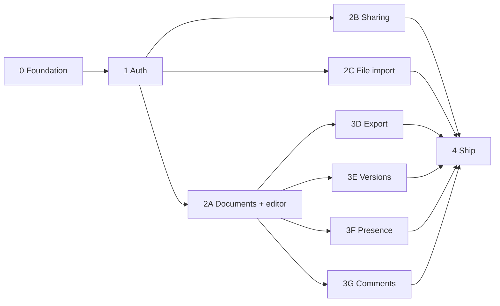

# Build Plan (~2 hours)

> **At a glance**
> - **Target:** a **~2 h build** ([D18](DECISIONS.md#d18--timebox-2-hours-of-build-time-2026-11-22)) in **5 stages**: Foundation → Auth → 3 core features in parallel → 4 extras in parallel → Ship.
> - **Parallelism:** after the foundation, features are built by **separate AI agents in isolated worktrees** ([D21](DECISIONS.md#d21--parallel-development-2026-11-22)); the **full schema is defined up front** so they don't collide.
> - **Outcome:** all phases shipped; **FR-1 to FR-10 are implemented and deployed** ✅ (see [REQUIREMENTS.md](REQUIREMENTS.md)).
> - **References:** Scope: [REQUIREMENTS.md](REQUIREMENTS.md) · Decisions: [DECISIONS.md](DECISIONS.md) · Git flow: [D19](DECISIONS.md#d19--git-workflow-gitflow-lite-with-prs-2026-11-22) · Tests: [D20](DECISIONS.md#d20--testing-strategy-tdd-lean-and-targeted-2026-11-22) · [../ARCHITECTURE.md](../ARCHITECTURE.md)

---

## Tech stack

| Concern | Choice |
|---|---|
| **App / framework** | Next.js (App Router, TypeScript strict) |
| **Styling** | Tailwind |
| **Editor** | TipTap |
| **Database** | Drizzle ORM + Supabase Postgres (transaction pooler) |
| **File storage** | Supabase Storage (signed upload URLs) |
| **Presence** | Supabase Realtime |
| **Validation** | zod |
| **Session / passwords** | jose (JWT session) · bcryptjs |
| **Import converters** | mammoth (.docx) · marked (.md) |
| **Tests** | Vitest + PGlite |
| **Hosting** | Vercel |

---

## Phases



> **Phases 2A/2B/2C run in parallel** after Phase 1 is merged. **Phases 3D–3G run in parallel** after 2A is merged (they plug into the editor).
> Each feature: PR → `develop` → merge → PR `develop` → `main` → merge → sync locals.

| Phase | Branch | Who | Est. | Contents | Commits (approx.) |
|---|---|---|---|---|---|
| **0 Foundation** | `feature/foundation` | main | 20 min | Scaffold Next.js; folder structure; env config validation; AppError + error envelope + API wrapper; logger; Drizzle client + **full schema** + migration + seed (alice/bob/carol); Vitest + PGlite harness; access policy (TDD) | 5–6 |
| **1 Auth** | `feature/auth` | main | 15 min | password + JWT session lib; login/logout/me routes; page guard middleware; login page. Tests: unit (session, validator) + integration (login) | 3–4 |
| **2A Documents + editor** | `feature/documents-editor` | agent A (worktree) | 35 min | documents repo/service/routes (CRUD, rename, optimistic version check → 409); dashboard (My docs / Shared with me); TipTap editor + toolbar (B/I/U, H1–H3, lists, text color, highlight, tables, undo/redo); autosave hook + status; header slot for Share/Import/etc. | 4–5 |
| **2B Sharing** | `feature/sharing` | agent B (worktree) | 25 min | share repo/service/routes (add by email, change role, revoke, list); ShareDialog component. Tests: unit (self-share, unknown user, duplicate → role update) + integration | 3–4 |
| **2C File import** | `feature/file-import` | agent C (worktree) | 30 min | file-sniffer (TDD: magic bytes, UTF-8/NUL check, size); converters txt/md/docx → TipTap JSON; `POST /uploads/sign` (signed URL), `POST /documents/import`; UploadDialog with limits shown. Tests: unit (sniffer, converters) + integration (import) | 4 |
| **3D Export** | `feature/export` | agent D | 15 min | JSON → Markdown (GFM tables) route; print stylesheet + "Export PDF" | 2–3 |
| **3E Versions** | `feature/version-history` | agent E | 20 min | auto snapshot (≤1 per 5 min) + manual; list, preview, non-destructive restore; side panel | 3 |
| **3F Presence** | `feature/presence` | agent F | 15 min | Supabase Realtime presence channel per doc; avatars + "editing…" | 2 |
| **3G Comments** | `feature/comments` | agent G | 25 min | comment mark anchored to selection; sidebar; reply; resolve | 3–4 |
| **4 Ship** | `feature/docs-deploy` | main | 15 min | Full test run + build + lint; deploy to Vercel; [README](../README.md), [ARCHITECTURE.md](../ARCHITECTURE.md), [AI_WORKFLOW.md](../AI_WORKFLOW.md), [SUBMISSION.md](../SUBMISSION.md) | 3 |

---

## Folder structure (modular monolith)

```
src/
├── app/                        # routes only: pages + thin API route handlers
│   ├── login/                  # login page
│   ├── documents/              # dashboard + [id]/ editor page
│   └── api/                    # auth, documents, shares, uploads, versions, comments, export
├── server/                     # backend
│   ├── config/                 # env schema (zod), app config
│   ├── constants/              # roles, limits, error codes, MIME rules
│   ├── exceptions/             # AppError hierarchy + error → HTTP mapper
│   ├── middleware/             # API route wrapper ("interceptor"): auth, validation, request id, logging, error mapping
│   ├── db/                     # drizzle client, schema/, migrations/, seed.ts
│   ├── repositories/           # data access only
│   ├── services/               # business logic (+ access-policy.ts)
│   ├── validators/             # zod request schemas
│   └── lib/                    # session, password, storage, file-sniffer, converters, logger
├── components/                 # editor/, documents/, sharing/, upload/, versions/, comments/, ui/
├── hooks/                      # useAutosave, usePresence, ...
├── types/                      # shared DTOs / domain types (type-only)
├── utils/                      # pure helpers
└── middleware.ts               # page auth guard (redirect to /login)
tests/
├── unit/
├── integration/                # PGlite + real migrations
└── helpers/                    # test DB factory, fixtures
```

> **Dependency direction:** route → service → repository → db. See [../ARCHITECTURE.md](../ARCHITECTURE.md) and [D2](DECISIONS.md#d2--backend-architecture-modular-monolith-2026-11-22).

---

## Database schema (all tables defined in Phase 0)

| Table | Columns |
|---|---|
| `users` | id, email (unique), name, password_hash, created_at |
| `documents` | id, owner_id → users, title, content (jsonb), version (int, optimistic lock), created_at, updated_at |
| `document_shares` | id, document_id → documents (cascade), user_id → users, role (`viewer`/`editor`), created_at · unique(document_id, user_id) |
| `document_versions` | id, document_id (cascade), content (jsonb), title, created_by, created_at |
| `comments` | id, document_id (cascade), author_id, anchor_id, quote, body, resolved, parent_id (nullable), created_at |
| `uploads` | id, owner_id, storage_path (unique), original_name, mime_type, size, status, document_id (nullable), created_at |

**Indexes:** `documents(owner_id)`, `document_shares(user_id)`, `document_versions(document_id, created_at)`, `comments(document_id)`.

---

## Points that needed human input or approval during the build

| # | Action | Phase |
|---|---|---|
| 1 | **Running the migration + seed on the hosted Supabase DB** (remote DB write, so the harness asks for approval). One approval. | 0 |
| 2 | **Creating the private Storage bucket** `document-uploads` (2 MB limit, allowed MIME list), via the API with the service key. | 0 |
| 3 | **Vercel:** you need to be logged in (`! npx vercel login`) and to approve the deploy and the env-var setup there. | 4 |

---

## Speed levers (used only if we fall behind)

| Lever | Saves |
|---|---|
| Comments: document-level threads instead of text-anchored ones | ~10 min |
| Versions: manual "Save version" only, no auto snapshot | ~5 min |
| Tier 2 features are independent, so any of them can be cut and listed as "next" | Varies |
