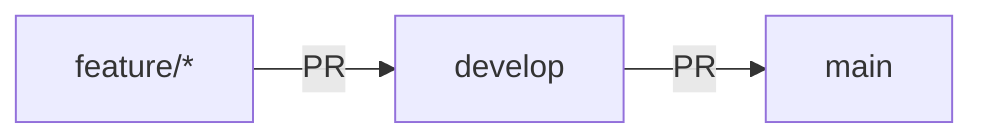

# Decisions Log

Decisions I (**Sagar**) made before and during the Ajaia AI-Native Assessment, with the reasons behind each one.
New decisions go at the bottom with the date. Real secret values never go in this file.

> **At a glance**
> - **21 decisions (D1–D21)**, all dated 2026-11-22. D1–D6 are my standing defaults; D7–D21 were made for this assessment.
> - **Stack:** one **Next.js 15 (TypeScript strict)** app + **Drizzle** + **Supabase** (Postgres, Storage, Realtime), deployed on **Vercel**.
> - **Every decision is mine.** Where the AI proposed or flagged something, the table says so; full record in [Who proposed what](#how-decisions-were-made-for-ai_workflowmd).
> - **Related:** [REQUIREMENTS.md](REQUIREMENTS.md) · [BUILD_PLAN.md](BUILD_PLAN.md) · [../ARCHITECTURE.md](../ARCHITECTURE.md) · [../AI_WORKFLOW.md](../AI_WORKFLOW.md) · [../README.md](../README.md)

---

## Summary table

| ID | Decision | Decided by | Why (short) |
|---|---|---|---|
| [D1](#d1--how-the-stack-is-chosen-2026-11-22) | Stack rule: AI task → Next.js + Python (FastAPI); otherwise Next.js for both | Sagar | Python has the best AI ecosystem; one Next.js codebase is faster for plain CRUD |
| [D2](#d2--backend-architecture-modular-monolith-2026-11-22) | Backend is a **modular monolith** with strict layers | Sagar | Separation of concerns, testable layers, can be split later |
| [D3](#d3--environment-and-config-2026-11-22) | `.env.example` committed, `.env` gitignored, all config from env | Sagar | No hardcoded settings, no secrets in git |
| [D4](#d4--database-supabase-postgres-via-the-async-transaction-pooler-2026-11-22) | Supabase Postgres via the **transaction pooler** (prepared statements off) | Sagar | Free hosted Postgres, same locally and in prod |
| [D5](#d5--deployment-2026-11-22) | The project is deployed; prod env vars only in the hosting dashboard | Sagar | Live URL for reviewers; nothing secret committed |
| [D6](#d6--assessment-workflow-2026-11-22) | 240-min workflow: scope → build → deploy + docs; Claude Code as AI pair | Sagar | Graded on AI leverage, execution, decisions, communication |
| [D7](#d7--stack-nextjs-typescript-full-stack-no-python-backend-2026-11-22) | **Next.js (TypeScript) full stack**, no Python backend | Sagar (rule D1); AI flagged the cold-start risk, Sagar confirmed | Non-AI task; one deploy, shared types, no ~50 s cold start |
| [D8](#d8--database--storage-supabase-2026-11-22) | Supabase **Postgres** + private **Storage** bucket | Sagar; AI flagged the asyncpg URL form doesn't work in Node, Sagar switched the scheme | Serverless-safe pooler connection from Node |
| [D9](#d9--auth-seeded-users-email--password-2026-11-22) | Seeded users, email + password, JWT cookie; roles **per share** | Sagar | Brief allows seeded users; proves session + authz without an auth product |
| [D10](#d10--file-upload-via-backend-issued-signed-urls--content-sniffing-2026-11-22) | **Signed-URL upload** + **byte-level content sniffing** | Sagar | No storage credentials in browser; extension/MIME can be faked |
| [D11](#d11--editor-tiptap-content-stored-as-json-2026-11-22) | **TipTap**, content stored as **JSON** | AI proposed, Sagar reviewed & accepted | Structure-preserving, no stored-HTML XSS, easy export |
| [D12](#d12--feature-scope--priority-tiers-2026-11-22) | Feature **priority tiers** (core / extras / stretch) | AI proposed, Sagar reviewed & accepted | Every stopping point is a coherent product |
| [D13](#d13--concurrency-presence--optimistic-locking-not-co-editing-2026-11-22) | **Presence + optimistic locking**, not CRDT co-editing | AI proposed, Sagar reviewed & accepted | Honest collaboration, never silently overwrites |
| [D14](#d14--engineering-workflow-2026-11-22) | Layered folders, separate unit/integration test trees, small commits | Sagar | Reviewable history and clean structure |
| [D15](#d15--scope-lock-2026-11-22) | Scope lock: **suggestion mode dropped**; viewer + editor roles; **Drizzle**; login-only auth | Sagar (suggestion mode: AI flagged paid-only, Sagar dropped it; Drizzle: AI proposed, Sagar accepted) | Paid TipTap Pro extension is forbidden; protect the core |
| [D16](#d16--production-grade-api-conventions-2026-11-22) | API conventions: migrations, zod validation, response envelope, middleware, **route-wrapper interceptor** | Sagar | One place for cross-cutting concerns |
| [D17](#d17--environment-file-location-2026-11-22) | Env at project root: `.env.local` + `.env.example`; server secrets validated at startup | Sagar | Single app; app refuses to boot with missing secrets |
| [D18](#d18--timebox-2-hours-of-build-time-2026-11-22) | **~2 h build** timebox; simplify instead of silently skipping | Sagar | Leaves time for docs, deploy, video |
| [D19](#d19--git-workflow-gitflow-lite-with-prs-2026-11-22) | **GitFlow-lite:** `feature/*` → `develop` → `main`, via PRs, merge commits | Sagar | Small commits stay visible; `main` only via PR |
| [D20](#d20--testing-strategy-tdd-lean-and-targeted-2026-11-22) | **TDD** for risky pure logic; unit + one integration test per module (Vitest + PGlite) | Sagar | Test where bugs hurt, not for coverage numbers |
| [D21](#d21--parallel-development-2026-11-22) | Features built **in parallel by AI agents** in isolated worktrees | Sagar | Schema and types fixed up front, so no conflicts |

---

## Standing defaults (D1–D6)

## D1 — How the stack is chosen (2026-11-22)

| If the task is… | Stack |
|---|---|
| **AI-based** | Next.js frontend + **Python (FastAPI)** backend |
| **A normal (non-AI) app** | **Next.js for both** frontend and backend |

**Why:** Python has the strongest AI/LLM ecosystem (SDKs, agents, RAG tooling). For a plain CRUD app, one Next.js codebase is faster to build and deploy in a 4-hour window.

## D2 — Backend architecture: modular monolith (2026-11-22)

One deployable app, split into layers and modules with clear boundaries. Production-grade layout:

```
backend/
├── app/
│   ├── main.py          # app factory, router registration
│   ├── config/          # settings (env-driven), logging, kept separate from constants
│   ├── constants/       # enums and fixed values
│   ├── exceptions/      # custom exceptions + global handlers (a folder, not one file)
│   ├── shared/          # shared models/schemas, exported and reused across modules
│   ├── agents/          # LLM agents, prompts, tools (if the task is AI-based)
│   ├── api/             # routes/controllers, per module (v1/)
│   ├── services/        # business logic
│   ├── repositories/    # data access
│   └── db/              # engine/session, base models
├── tests/
└── requirements.txt / pyproject.toml
```

- **One file per module per layer**, e.g. `api/documents.py` → `services/documents.py` → `repositories/documents.py`.
- **Dependency direction:** api → services → repositories → db. Lower layers never import upper ones.
- If the backend is in Next.js, the same layers go under `src/server/`.
- The architecture and folder layout must be documented in the [README](../README.md) and [ARCHITECTURE.md](../ARCHITECTURE.md).

**Why:** this is how I build production backends. It keeps concerns separate, makes each layer testable on its own, and could later be split into services without rewriting.

## D3 — Environment and config (2026-11-22)

| File | Committed? | Contents |
|---|---|---|
| `.env.example` | **Yes** | Placeholders only |
| `.env` | **No** (gitignored) | Real values |

- `.gitignore` excludes `.env` and `.env.*` but allows `.env.example`.
- All settings are read from environment variables in `config/`. **Nothing is hardcoded.**
- Variable names: `APP_ENV`, `APP_NAME`, `LOG_LEVEL`, `CORS_ORIGINS`, `DATABASE_URL`, `SUPABASE_URL`, `SUPABASE_ANON_KEY`, `SUPABASE_SERVICE_ROLE_KEY`, `LLM_PROVIDER`, `LLM_API_KEY`, `LLM_MODEL`.
- I fill in `backend/.env` myself. Claude's harness blocks it from writing real keys into files.

## D4 — Database: Supabase Postgres via the async transaction pooler (2026-11-22)

- Hosted Supabase project in region `ap-south-1`.
- **Connection:** `postgresql+asyncpg://...pooler.supabase.com:6543/postgres`, the **transaction pooler**, used with FastAPI and async SQLAlchemy.
- This is a **remote** database, so migrations and table creation are run only after I approve them.

> **Technical gotcha:** the transaction pooler (port 6543) does **not** support prepared statements. The async engine must set `statement_cache_size=0` (and `prepared_statement_cache_size=0`) and use a pooler-safe pool (e.g. NullPool).

**Why:** free hosted Postgres, deploy-ready, works the same locally and in production.

> **To do after the assessment:** rotate the DB password and service-role key in the Supabase dashboard. They were shared in a chat.

## D5 — Deployment (2026-11-22)

- The project will be deployed (frontend: **Vercel**; backend: Render or similar, final choice once the brief is known).
- Production env vars are set in the hosting dashboard, **never committed**.

## D6 — Assessment workflow (2026-11-22)

| Item | Detail |
|---|---|
| **Timer** | 240 minutes |
| **Graded on** | AI leverage, execution quality, decision-making, communication |
| **Plan** | ~15 min scoping → ~2.5 h build (small tested steps, frequent commits) → ~30–40 min deploy + docs |
| **Deliverables** | [README](../README.md), [ARCHITECTURE.md](../ARCHITECTURE.md), [AI_WORKFLOW.md](../AI_WORKFLOW.md) (prompts, where the AI was wrong, how output was verified), submission Markdown ([SUBMISSION.md](../SUBMISSION.md)), walkthrough video (recorded by me, in my own words) |
| **AI pair** | Claude Code. **Every decision is mine and recorded here.** |
| **GitHub CLI** | Logged in as `sagarrajak245` |

---

## Log of later decisions (D7–D21)
<!-- Add new entries below as: ## D<n> — <title> (date) / decision / why -->

## D7 — Stack: Next.js (TypeScript) full stack, no Python backend (2026-11-22)

**Decision:** one Next.js App Router app in **TypeScript (strict)** for both UI and backend (Route Handlers under `app/api`, business logic in a layered `server/` folder).

| | Separate FastAPI service | One Next.js app (chosen) |
|---|---|---|
| Deployments | Two | **One** (Vercel) |
| CORS | Needed | Not needed |
| Types | Duplicated type layer | **Shared types between client and server** |
| First load for a reviewer | Free-tier backend cold-starts (~50 s) | **Instant live URL** |

- **Why not FastAPI here:** by rule D1 this is a non-AI product task.
- **What is kept from my backend standard:** the same modular-monolith layering (config / constants / exceptions / shared / types / utils / services / repositories / API), just in TypeScript.

## D8 — Database & storage: Supabase (2026-11-22)

- Supabase **Postgres** for all data; Supabase **Storage** (private bucket) for uploaded files.
- From Node the connection uses the **transaction pooler (6543)** with prepared statements disabled (serverless-safe). The asyncpg URL form is only for Python.

## D9 — Auth: seeded users, email + password (2026-11-22)

- Seeded demo accounts, login with email + password (**bcrypt** hash), session in an **httpOnly signed JWT cookie**. No Supabase Auth, no signup.
- **Roles are per document share**, not per user account (a person can be an editor on one doc and a viewer on another, the same as Google Docs).

**Why:** the brief allows mocked/seeded users; this proves session + authorization logic without spending the timebox on an auth product.

## D10 — File upload via backend-issued signed URLs + content sniffing (2026-11-22)

**Flow:** backend validates metadata and issues a **short-lived signed upload URL** → the frontend uploads bytes **directly to Supabase Storage** → backend verifies and imports.

| Choice | Why |
|---|---|
| **Signed URLs** instead of uploading through our API | The browser never holds storage credentials; the server controls the object path and expiry; file bytes don't pass through serverless functions (Vercel's request-body limit and execution time are not a concern). |
| **Content sniffing** | The extension and `Content-Type` are client-controlled and can be faked. `.docx` is verified by ZIP magic bytes (`PK\x03\x04`) + presence of `word/document.xml`; `.txt/.md` have no magic number, so they are verified as valid UTF-8 with no NUL bytes. Real stored size is re-checked server-side. |
| **Limits** | `.txt`, `.md`, `.docx`; max **2 MB**; shown in the UI and [README](../README.md). |

## D11 — Editor: TipTap, content stored as JSON (2026-11-22)

- **TipTap** (ProseMirror) with free extensions: StarterKit, Underline, TextStyle + Color, Highlight, Table.
- Content stored as **editor JSON, not HTML**: structure-preserving, no XSS risk from stored HTML, and easy to convert to Markdown/PDF.

## D12 — Feature scope & priority tiers (2026-11-22)

| Tier | Contents |
|---|---|
| **1: core, must be perfect** | Auth, dashboard, editor + autosave, formatting (incl. colors & tables), file import, sharing with viewer/editor roles, tests, deploy |
| **2: extras, independent** | Export MD/PDF, version history, presence indicators, comments |
| **3** | Suggestion mode, only if everything else is polished (later dropped, see D15) |

**Why:** the brief rewards depth over breadth and says not to sacrifice core for stretch. Tiers make every stopping point a coherent product. Full detail: [REQUIREMENTS.md](REQUIREMENTS.md).

## D13 — Concurrency: presence + optimistic locking, not co-editing (2026-11-22)

- **Presence** (who's viewing/editing) via Supabase Realtime; saves carry a `version` and return **`409`** on conflict.

**Why:** real CRDT co-editing is out of scope for the timebox. This combination is honest about collaboration and **never silently overwrites someone's work**.

## D14 — Engineering workflow (2026-11-22)

- Modular monolith; separate `types/`, `utils/`, `services/`, `repositories/`, API route folders; well-commented code.
- Tests in a separate `tests/` tree: `unit/`, `integration/` (+ `e2e/` smoke if time).
- **Small, meaningful commits:** each module is split into 3–4+ commits at its natural steps (schema → repository → service → route → UI → tests), never one big commit at the end.

## D15 — Scope lock (2026-11-22)

| Topic | Decision | Reason |
|---|---|---|
| **Suggestion mode** | **Dropped** | Only available as a paid TipTap Pro extension (the brief forbids paid dependencies); a custom track-changes build is 2+ hours across every editing path. Comments cover the "feedback without editing" need. |
| **Sharing roles** | **Viewer + editor** | Viewer = read + comment; Editor = edit content/title + comment; Owner = everything + manage sharing + delete. |
| **ORM** | **Drizzle** | Lightweight, SQL-close, serverless-friendly; works on the transaction pooler with prepared statements off; migrations are plain SQL files that can be reviewed. |
| **Auth** | **Login only, seeded accounts** | Reviewers get ready-made accounts to test sharing straight away; no signup surface to build and secure. |

## D16 — Production-grade API conventions (2026-11-22)

| Concern | Convention |
|---|---|
| **Database versioning** | Schema defined in code (`server/db/schema/`) and changed only through **versioned Drizzle migrations** (generated SQL files, committed, reviewed). No ad-hoc schema edits. |
| **Validation** | Every request body, query and route param is validated with **zod** schemas in `server/validators/` before reaching a service. The same schemas produce the TypeScript request types. |
| **Request/response contract** | Typed DTOs in `types/`. Success → `{ data: ... }`; error → `{ error: { code, message, details? } }` with a stable `code` enum from `constants/`. Correct HTTP status codes everywhere (400/401/403/404/409/413/415/422/500). |
| **Middleware** | Next.js middleware guards page routes (no session → redirect to `/login`). |
| **Interceptor (route wrapper)** | Every API route is wrapped by one higher-order handler that does what an interceptor does in NestJS/Spring: resolve the session (auth), validate input, attach a request ID, log timing, and **catch every thrown `AppError` and map it to the error envelope**. Route files stay a few lines long. |

> **Why:** one place for cross-cutting concerns means **no endpoint can forget auth, validation or error formatting**.

## D17 — Environment file location (2026-11-22)

- Single Next.js app, so env lives at the project root: `.env.local` (gitignored, real values) and `.env.example` (committed, empty placeholders).
- Supabase URL and anon key are exposed as `NEXT_PUBLIC_*` (safe: anon key, used only for Realtime presence).
- `SUPABASE_SERVICE_ROLE_KEY`, `DATABASE_URL` and `SESSION_SECRET` are **server-only** and validated at startup by `server/config`; **the app refuses to boot if any is missing**.

## D18 — Timebox: ~2 hours of build time (2026-11-22)

- The brief allows 4–6 h; I'm targeting a **~2 h build**, then docs, deploy and video.
- Tier 2 features are independent, so any of them can be cut at the deadline without breaking the product.

> **Rule for staying on time:** when something is slow, **simplify instead of skipping it silently**, and record the simplification here.

## D19 — Git workflow: GitFlow-lite with PRs (2026-11-22)



- `main` is created on GitHub (public repo). `develop` branches from `main`. Every feature branches from `develop`.
- Feature done → **PR into `develop`** → merge → **PR `develop` into `main`** → merge → sync local `main` and `develop` with origin → next feature branches from the fresh `develop`.
- **Merge commits, not squash**, so the small step-by-step commits stay visible in history.
- Commits: small and descriptive, 3–4+ per feature at natural steps, Conventional Commits style (`feat(documents): add optimistic version check`).

> **Nothing is ever pushed directly to `main`**; it only changes through PRs.

## D20 — Testing strategy: TDD, lean and targeted (2026-11-22)

| Aspect | Approach |
|---|---|
| **TDD** | For pure, risky logic the failing test is written first (RED), then the code (GREEN): **access policy, upload content sniffing, request validators, content converters**. |
| **Unit tests (per module)** | Happy path + the important edge cases (e.g. viewer tries to edit → forbidden; `.exe` renamed to `.docx` → rejected; empty/oversized title → rejected; stale version on save → conflict). |
| **Integration test (per module)** | One, after the module is done: the real service + repository against a **real Postgres engine** (in-memory **PGlite** running our actual Drizzle migrations), so SQL, constraints and joins are exercised without touching the hosted database. |
| **Deliberately not doing** | UI snapshot tests, exhaustive coverage targets, E2E browser tests (a manual smoke run of the main flow replaces them, and it is documented). |
| **Tools** | **Vitest** (fast, TypeScript-native) + **PGlite** |

**Why:** the brief asks for "at least one meaningful test". Tests here target where bugs would actually hurt (**authorization, upload safety, data integrity**), not coverage numbers.

## D21 — Parallel development (2026-11-22)

- After the shared foundation (schema, auth, error handling, access policy) is merged, independent features are built **in parallel by separate AI agents, each on its own feature branch in an isolated git worktree**.
- **Conflicts are avoided by design:** the **whole DB schema and shared types are defined up front** in the foundation, and each feature owns its own folders (service, repository, routes, components). Shared screens get a small integration step at merge time.

---

## How decisions were made (for AI_WORKFLOW.md)

Accurate record of who proposed what (also used in [../AI_WORKFLOW.md](../AI_WORKFLOW.md)):

| Who | What |
|---|---|
| **Mine (I specified)** | Stack rule (AI → Python, else Next.js); modular-monolith layering; `.env.example` + `.env.local`; Supabase as DB/storage; **signed-URL upload issued by the backend with direct browser→storage upload**; **file-type limits + byte-level content-type sniffing**; viewer/editor sharing; feature set incl. tables, text/background color, export, versions, presence, comments; validation, request/response contract, middleware/interceptor; small commits per step; separate unit/integration test trees. |
| **AI proposed, I reviewed and accepted** | TipTap with JSON storage; Drizzle over Prisma; priority tiers; presence + optimistic locking instead of CRDT co-editing; print-CSS PDF export. |
| **AI flagged, I decided** | Suggestion mode is paid-only in TipTap, so I dropped it; Python backend would cold-start on free hosting, so I confirmed full Next.js; the asyncpg URL form doesn't work in Node, so the scheme was switched. |
