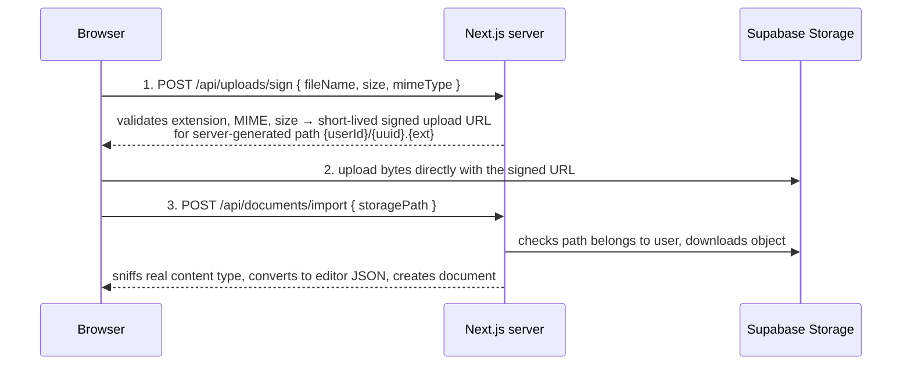

# Requirements: Collaborative Document Editor (Ajaia Assessment)

**Author:** Sagar · **Status:** Scope locked ✅ · **Date:** 2026-11-22

> **At a glance**
> - **What:** a lightweight **Google-Docs-style editor**: create, edit, import, share and collaborate on documents.
> - **Built:** **FR-1 to FR-10 are implemented and deployed** ✅. **FR-11 suggestion mode was dropped** (paid TipTap extension, see [D15](DECISIONS.md#d15--scope-lock-2026-11-22)).
> - **Rule:** everything we build is listed here. Anything not listed is out of scope.
> - **Related:** [DECISIONS.md](DECISIONS.md) (why) · [BUILD_PLAN.md](BUILD_PLAN.md) (how/when) · [../ARCHITECTURE.md](../ARCHITECTURE.md) · [../README.md](../README.md)

This document turns the open-ended brief into a fixed, buildable scope.

---

## 1. Problem framing

Ajaia wants an internal productivity tool: a **lightweight Google-Docs-style editor** where a team can create, edit, import, share and collaborate on documents.

> The brief rewards **depth over breadth** and **explicit trade-offs**.

So the plan is to:

1. **Make the core document loop excellent:** create → edit → autosave → reopen, with formatting preserved.
2. **Build file upload and sharing with production-grade patterns:** signed URLs, content sniffing, server-side authorization.
3. **Add collaboration extras in priority order**, each one shippable on its own, and stop when the timebox runs out.

---

## 2. Functional requirements (FR): summary

| ID | Requirement | Tier | Status |
|---|---|---|---|
| FR-1 | Authentication (seeded users) | 1 Core | ✅ Implemented & deployed |
| FR-2 | Documents (create, rename, edit, autosave, reopen, delete) | 1 Core | ✅ Implemented & deployed |
| FR-3 | Rich-text formatting (incl. colors & tables) | 1 Core | ✅ Implemented & deployed |
| FR-4 | File upload: import `.txt` / `.md` / `.docx` into a new doc | 1 Core | ✅ Implemented & deployed |
| FR-5 | Sharing & access control (viewer / editor) | 1 Core | ✅ Implemented & deployed |
| FR-6 | Persistence + optimistic concurrency | 1 Core | ✅ Implemented & deployed |
| FR-7 | Export (Markdown, PDF) | 2 Extra | ✅ Implemented & deployed |
| FR-8 | Version history | 2 Extra | ✅ Implemented & deployed |
| FR-9 | Real-time presence indicators | 2 Extra | ✅ Implemented & deployed |
| FR-10 | Comments (anchored, reply, resolve) | 2 Extra | ✅ Implemented & deployed |
| ~~FR-11~~ | ~~Suggestion mode~~ | — | ❌ Dropped (paid TipTap Pro extension; see [§6](#6-out-of-scope--explicit-scope-decisions) and [D15](DECISIONS.md#d15--scope-lock-2026-11-22)) |

---

## 3. Functional requirements: detail

### FR-1 Authentication (seeded users)

| ID | Requirement |
|---|---|
| FR-1.1 | A user logs in with **email + password**. Accounts are **seeded** (no public signup); demo credentials are listed in the [README](../README.md). |
| FR-1.2 | Session is kept in an **httpOnly, signed (JWT) cookie**; logout clears it. |
| FR-1.3 | Every page and API except `/login` requires a valid session. Unauthenticated requests are **redirected** (pages) or get **`401`** (API). |

### FR-2 Documents

| ID | Requirement |
|---|---|
| FR-2.1 | Create a new blank document (default title "Untitled document"). |
| FR-2.2 | Rename a document inline. Title is trimmed and must be **1–200 characters**. |
| FR-2.3 | Edit content in the browser with a rich-text editor. |
| FR-2.4 | **Autosave** with debounce (~1 s after the user stops typing), plus a visible save status: *Saving… / Saved / Failed – retry*. |
| FR-2.5 | Reopen any accessible document from the dashboard; content and formatting come back exactly as saved. |
| FR-2.6 | Delete a document (**owner only**, with a confirmation dialog). |

### FR-3 Rich-text formatting

| ID | Requirement |
|---|---|
| FR-3.1 | **Bold, italic, underline** (toolbar buttons + standard keyboard shortcuts). |
| FR-3.2 | **Headings H1–H3** and normal paragraph text. |
| FR-3.3 | **Bulleted and numbered lists**. |
| FR-3.4 | **Text color** and **background (highlight) color** from a fixed palette. |
| FR-3.5 | **Tables:** insert a table, add or remove rows and columns, delete the table. |
| FR-3.6 | **Undo / redo**. |

> **Storage format:** content is stored as **structured editor JSON** (ProseMirror/TipTap document), **not raw HTML**, so structure is preserved and safe to re-render.

### FR-4 File upload (import into a new document)

| ID | Requirement |
|---|---|
| FR-4.1 | Supported types: **`.txt`, `.md`, `.docx`**, max **2 MB**. The limits are shown in the upload dialog and the [README](../README.md). |
| FR-4.2 | **Signed-URL upload flow.** The browser never gets storage credentials (steps below). |
| FR-4.3 | **Content sniffing:** the extension and the browser's MIME type are **not trusted** (rules below). |
| FR-4.4 | **Conversion:** `.txt` → paragraphs · `.md` → headings/lists/emphasis preserved · `.docx` → headings, lists, bold/italic preserved (via `mammoth`). Unsupported formatting is dropped gracefully. |
| FR-4.5 | **Defense in depth:** the Storage bucket is **private**, with a bucket-level size limit and allowed-MIME list. Clear error messages for each rejection reason. |

**FR-4.2 Signed-URL upload flow**

1. Client → `POST /api/uploads/sign` `{ fileName, size, mimeType }`. Server validates extension, declared MIME type and size, then returns a **short-lived Supabase Storage signed upload URL** for a server-generated path (`{userId}/{uuid}.{ext}`).
2. Client uploads the file bytes **directly to Supabase Storage** using that signed URL. No file bytes pass through our Next.js server, so there is no serverless body-size limit.
3. Client → `POST /api/documents/import` `{ storagePath }`. Server checks the path belongs to the user, downloads the object and **verifies the real content type from its bytes** (FR-4.3), converts it to editor JSON and creates a new document owned by the user.

**FR-4.3 Content-sniffing rules**

| File type | Check |
|---|---|
| `.docx` | Must start with the ZIP magic bytes `50 4B 03 04` **and** contain `word/document.xml`; otherwise rejected. |
| `.txt` / `.md` | Plain text has no magic number, so the bytes must be **valid UTF-8** with **no NUL bytes** (a binary file disguised as `.txt` fails this). |
| All | Server re-checks the **real stored size** (the declared size can be faked). |

### FR-5 Sharing & access control

| ID | Requirement |
|---|---|
| FR-5.1 | Each document has exactly one **owner** (its creator). |
| FR-5.2 | The owner shares a document by entering another user's **email** and choosing a role (table below). |
| FR-5.3 | Owner can **change** a share's role or **revoke** access. |
| FR-5.4 | Dashboard shows two clearly separated sections, **"My documents"** and **"Shared with me"**, with owner name and role badges. |
| FR-5.5 | **All authorization is enforced server-side** in a single access-policy module (`canView / canEdit / canManage`). The UI only reflects it; it never decides it. Unauthorized → **`403`**, unknown document → **`404`**. |
| FR-5.6 | Validation: can't share with yourself, with a non-existent user, or create a duplicate share (it **updates the role** instead). |

| Role | Read | Comment | Edit content & title |
|---|---|---|---|
| **Viewer** | ✅ (editor shown read-only) | ✅ | — |
| **Editor** | ✅ | ✅ | ✅ |

> **Authorization lives on the server.** The UI never decides who can do what.

### FR-6 Persistence

| ID | Requirement |
|---|---|
| FR-6.1 | Users, documents, shares, versions, comments and upload records are stored in **Supabase Postgres**. |
| FR-6.2 | Documents survive refresh and re-login. Formatting is preserved (JSON content). |
| FR-6.3 | **Optimistic concurrency:** each save sends the document's `version` number. If someone else saved in between, the server returns **`409 Conflict`** and the UI shows "This document was updated elsewhere — reload". **No silent overwrite.** |

### FR-7 Export

| ID | Requirement |
|---|---|
| FR-7.1 | **Export as Markdown:** server converts editor JSON → Markdown and downloads a `.md` file. Tables → GFM tables; colors are dropped (Markdown can't represent them), and this is documented. |
| FR-7.2 | **Export as PDF:** a dedicated print stylesheet plus the browser's print-to-PDF. Text stays **real, selectable and searchable** (not a screenshot image), and colors and tables are kept. |

### FR-8 Version history

| ID | Requirement |
|---|---|
| FR-8.1 | A snapshot is stored automatically on autosave, at most **one per 5 minutes** per document, plus manually via **"Save version"**. |
| FR-8.2 | Version panel lists snapshots (time, author). Selecting one shows a read-only preview. |
| FR-8.3 | **Restore is non-destructive:** it creates a new version from the old content, so history is never lost. Owner/editor only. |
| FR-8.4 | Retention cap: latest **50 versions** per document. |

### FR-9 Real-time collaboration indicators (presence)

| ID | Requirement |
|---|---|
| FR-9.1 | Avatars of everyone currently viewing a document are shown in the header, updating live. |
| FR-9.2 | An "editing…" indicator appears for users who are actively typing. |

> **Scope:** implemented with **Supabase Realtime Presence** (WebSocket). This is *presence*, **not simultaneous co-editing** (CRDT/Yjs); concurrent writes are handled by FR-6.3.

### FR-10 Comments

| ID | Requirement |
|---|---|
| FR-10.1 | Select text → "Comment" → the comment is **anchored** to that range (highlighted in the document). |
| FR-10.2 | Comment sidebar: thread list with author and time, reply, **resolve/reopen**. |
| FR-10.3 | Owner, editors and viewers can comment; only the **author or the owner** can delete a comment. |

### ~~FR-11 Suggestion mode~~ (dropped)

Dropped: see [§6](#6-out-of-scope--explicit-scope-decisions) and [DECISIONS D15](DECISIONS.md#d15--scope-lock-2026-11-22).

---

## 4. Non-functional requirements (NFR)

| ID | Category | Requirement | Status |
|---|---|---|---|
| NFR-1 | **Security** | Server-side authz on every route; **bcrypt**-hashed passwords; httpOnly + `SameSite=Lax` + `Secure` (prod) session cookie; all inputs validated with **zod** at the API boundary; content-sniffed uploads; private storage bucket with signed URLs; the service-role key is **server-only** (never in the client bundle); no secrets in git (`.env.example` only). | ✅ |
| NFR-2 | **Reliability** | Consistent JSON error envelope `{ error: { code, message } }` with correct status codes (400/401/403/404/409/413/415/500); typed custom exceptions mapped centrally; optimistic concurrency on saves; autosave retry on failure. | ✅ |
| NFR-3 | **UX quality** | Loading, empty and error states on every screen; save-status indicator; toasts for actions; confirmation for destructive actions; keyboard shortcuts; accessible toolbar (aria-labels, focus states); responsive layout down to tablet width. | ✅ |
| NFR-4 | **Performance** | Debounced autosave (no save per keystroke); document content capped at ~1 MB; dashboard queries use indexed columns (`owner_id`, `document_id+user_id`); no file bytes routed through serverless functions. | ✅ |
| NFR-5 | **Maintainability** | TypeScript **strict**; modular monolith with strict layering (route → service → repository); shared types in `types/`; pure helpers in `utils/`; ESLint + Prettier; well-commented code; small, descriptive commits per step. | ✅ (ESLint; Prettier not configured) |
| NFR-6 | **Testability** | Unit tests for pure logic (validators, file sniffing, converters, access policy); integration tests for services and API routes; one end-to-end smoke test of the main flow if time allows. | ✅ unit + integration; E2E replaced by a manual smoke run ([D20](DECISIONS.md#d20--testing-strategy-tdd-lean-and-targeted-2026-11-22)) |
| NFR-7 | **Deployability & cost** | One Next.js app on **Vercel (free)** + **Supabase (free)**. Reviewers pay nothing. All config via env vars; one-command local setup; seed script for demo users. | ✅ |
| NFR-8 | **Observability** | Structured server logs for errors and key events (upload rejected, conflict, authz denied) with request context. Secrets and document content are never logged. | ✅ |

---

## 5. Feature list (built in this order)

| # | Feature | Tier | Covers |
|---|---|---|---|
| 1 | Login with seeded users (email + password), logout, protected routes | **1 Core: must be perfect** | FR-1 |
| 2 | Dashboard: "My documents" / "Shared with me", create, delete | 1 Core | FR-2, FR-5.4 |
| 3 | Editor: rename, autosave + status, reopen, conflict detection | 1 Core | FR-2, FR-6.3 |
| 4 | Formatting: B / I / U, H1–H3, bullet & numbered lists, undo/redo | 1 Core | FR-3 |
| 5 | Formatting extras: text color, background color, tables | 1 Core | FR-3.4, FR-3.5 |
| 6 | File import: `.txt` / `.md` / `.docx` ≤ 2 MB via signed URL + content sniffing | 1 Core | FR-4 |
| 7 | Sharing: by email, viewer/editor roles, revoke, server-side policy | 1 Core | FR-5 |
| 8 | Tests (unit + integration), README, deploy | 1 Core | NFR-6, NFR-7 |
| 9 | Export Markdown + PDF | **2 Extra: independent, shippable** | FR-7 |
| 10 | Version history (auto + manual snapshot, preview, restore) | 2 Extra | FR-8 |
| 11 | Presence indicators (who's viewing / editing) | 2 Extra | FR-9 |
| 12 | Comments (anchored, reply, resolve) | 2 Extra | FR-10 |
| — | ~~Suggestion mode~~ | Dropped | see §6 |

---

## 6. Out of scope / explicit scope decisions

| Not building | Why |
|---|---|
| Real-time **co-editing** (CRDT/Yjs, live cursors) | Needs a sync server and conflict-free data types, which can't be done well in the timebox. **Presence + optimistic concurrency** gives honest collaboration signals without risking data loss. |
| Public signup, password reset, OAuth | Brief allows seeded/mocked users; auth isn't what's being evaluated. |
| **Suggestion mode** | No free TipTap extension exists (it's in the **paid Pro tier**, and the brief forbids paid dependencies). A custom track-changes build is ~2+ hours and touches every editing path, which puts the core at risk. **Comments** cover the "give feedback without editing" need. |
| PDF/other file import, attachments | One upload flow done properly (signed URL + sniffing + conversion) beats several shallow ones. |
| Folders, search, templates, mobile-first layout | Breadth without depth. |
